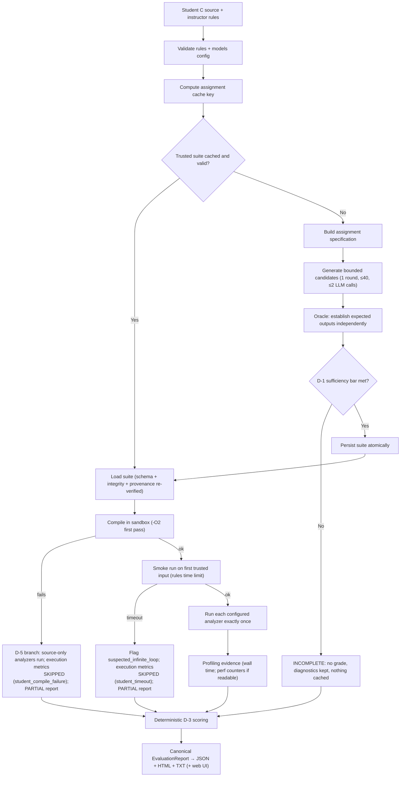

# AutoGrader — Runtime flow

This is the control flow implemented by `autograder/workflow.py`
(`evaluate_submission`), matching the assignment's intended flow.

## Branches and their scoring outcomes (D-3 policy `d3-v1`)

| Situation | Execution metrics | Overall status | Grade |
|---|---|---|---|
| Trusted evidence insufficient at setup | not run | `incomplete` | none |
| Required metric blocked by host/tool failure | — | `incomplete` (environment) | none |
| Optional metric unavailable | excluded, weights renormalized + disclosed | `complete` | yes |
| Compilation failure (student's fault) | skipped | `partial` | yes, from earned contributions; achievable maximum + coverage disclosed |
| Smoke-run timeout (student's fault) | skipped | `partial` | same as above |
| Required metric inconclusive (e.g. originality with an empty corpus) | scored where possible | `provisional` | per engine policy; disclosed |
| Normal run | all scored | `complete` | yes |

## Timing evidence

Every report carries an `execution_evidence` entry of type `timings` with
per-phase seconds (setup, compile, smoke, scoring) and per-analyzer
seconds, measured with a monotonic clock. The `benchmark` command aggregates
these across repetitions (see `docs/BENCHMARKS.md`).

## Per-student independence

Each evaluation compiles and executes in its own fresh sandbox workspace
with its own evidence; the only shared artifact between students is the
assignment-level trusted suite (never another student's results).
